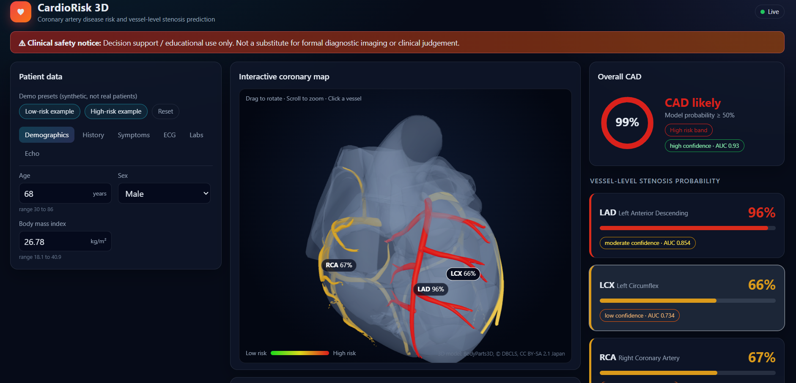
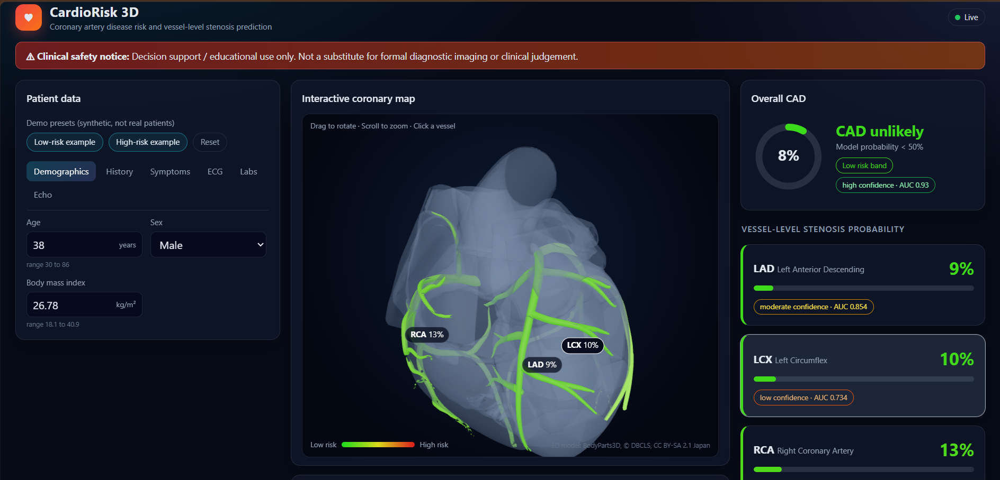
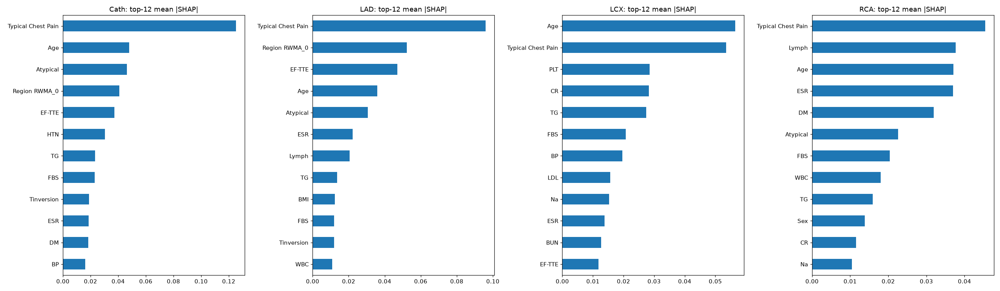

# CardioRisk 3D

A web app that estimates a patient's risk of **coronary artery disease (CAD)** and shows which
of the three main heart arteries (**LAD, LCX, RCA**) are likely to be narrowed. The result is
shown on an interactive 3D heart, together with an explanation of why the model gave that result.

> **Safety notice:** This tool is for decision support and education only.
> It is **not** a replacement for medical imaging or a doctor's judgement.

Originally built for the Multimodal AI Hackathon 2026 (Track A).

<!-- Add your screenshots to the docs folder, then keep these lines -->



## What it does

1. You enter patient data (age, blood pressure, lab values, ECG, echo and so on).
2. Four machine learning models predict: overall CAD, LAD, LCX and RCA narrowing.
3. The 3D heart colours each artery from green (low risk) to red (high risk).
4. A chart shows which inputs pushed the risk up or down.

You can rotate and zoom the heart, and click an artery to see why it got its score.

## Project structure

```
cardio-risk-3d-visualizer/
  backend/
    main.py                    The API server (FastAPI)
  frontend/
    src/                       The website (React)
    public/models/             3D heart files (heart, LAD, LCX, RCA, left main)
  ml_pipeline/
    data_cleaning.ipynb        Checking and cleaning the data
    eda.ipynb                  Exploring the data
    experiment.ipynb           Trying different ideas (models, features, settings)
    model_training.ipynb       Final training, testing, explanations and saving models
    pipeline.py                Shared code that prepares data for the models
    figures/                   Charts
    models/                    Saved models and files the app needs
  data/                        Dataset and EDA report
  requirements.txt             Python packages for the app
```

## How to run it

You need **Python 3.11** and **Node.js <your version, 20 or newer>**.

**Step 1: Get the code**

```powershell
git clone <your-repo-url>
cd cardio-risk-3d-visualizer
```

**Step 2: Set up Python**

```powershell
python -m venv env
env\Scripts\activate
pip install -r requirements.txt
```

**Step 3: Start the backend (keep this window open)**

```powershell
cd backend
uvicorn main:app --reload --port 8001
```

Check it works by opening http://127.0.0.1:8001/health in your browser.
You should see `{"status":"ok","n_features":54}`.

**Step 4: Start the website (open a second window)**

```powershell
cd frontend
npm install
npm run dev
```

**Step 5: Open the app**

Go to http://localhost:5173 in your browser.

## How to use the app

- Use the tabs on the left to enter patient data. The results update automatically.
- Try the **Low-risk example** and **High-risk example** buttons to see the colours change.
- Click an artery on the heart (or in the right-hand list) to see why it got its score.
- In the explanation chart, red bars raise the risk and blue bars lower it.

## Which inputs matter most



Each chart shows the 12 inputs that influenced one model the most. A longer bar means a bigger influence.

## Results

Each model was tested on patients it had not seen during training. The test was repeated
15 times (5 groups, repeated 3 times) to get a stable score.

| What is predicted | AUC | Accuracy | Precision | Recall | F1 |
|---|---|---|---|---|---|
| Overall CAD | 0.930 | 0.879 | 0.904 | 0.931 | 0.917 |
| LAD | 0.854 | 0.791 | 0.796 | 0.870 | 0.829 |
| LCX | 0.734 | 0.677 | 0.630 | 0.440 | 0.512 |
| RCA | 0.724 | 0.675 | 0.607 | 0.401 | 0.476 |

**How to read this table**

- **AUC:** how well the model puts risky patients above safe ones. 0.5 is a coin flip, 1.0 is perfect.
- **Accuracy:** how many patients were classified correctly.
- **Precision:** when the model says "narrowed", how often it is right.
- **Recall:** out of all patients who really had narrowing, how many the model found.
- **F1:** one score that balances precision and recall.

A model that always guesses the most common answer scores AUC 0.5.

**What this means:** the models work well for overall CAD and reasonably well for LAD.
They are weaker for LCX and RCA, so the app marks those two as **low confidence**.
Recall for LCX and RCA is low at the standard 50% cut-off, which means the model misses
many patients who really have narrowing in those arteries.

## How the models were built

- **Data:** the Z-Alizadeh Sani CAD dataset, 303 patients, no missing values.
- **No cheating:** the answer columns (LAD, LCX, RCA, Cath) are never given to the models as input.
- **Cleaning:** we removed columns that add nothing new.
  Exertional CP is the same for every patient. Weight and Length are already in BMI.
  Obesity is just a BMI flag. Neut is almost a copy of Lymph.
  CHF and LowTH Ang have only 1 and 2 patients. 54 input columns remain.
- **Model:** a Random Forest, one for each of the four questions.
- **Balanced classes:** we told the model that rare cases matter, so it misses fewer sick patients.
- **Probability fix:** we adjusted the probabilities so that "70%" means about 70%.
- **Explanation:** SHAP shows how much each input pushed the risk up or down for one patient.

We also tried other models, removing more columns, adding new columns and tuning settings
(see `experiment.ipynb`). None gave a clear improvement, so we kept the simple setup.

## Limitations

- The artery percentages are the **chance that an artery is at least 50% narrowed**.
  They do **not** show how bad the narrowing is, or where exactly it is.
- LCX and RCA predictions are weaker. Treat them with care.
- The overall CAD model and the three artery models are separate, so they can sometimes disagree.
  The app shows a warning when this happens.
- The data is only 303 patients from one dataset and was not tested on outside data.
- The Low / Moderate / High labels in the app are only a display choice, not medical rules.
- The 3D heart is a general model, not the patient's own heart.
- Arteries are coloured as groups (LAD, LCX, RCA), not branch by branch.
- The explanation chart is built from a slightly different copy of the model (before the
  probability fix), so its numbers show direction and ranking, not exact percentages.

## Credits

- Dataset: Extension of the Z-Alizadeh Sani dataset, UCI Machine Learning Repository. <add citation from the UCI page>
- 3D heart: BodyParts3D, (c) The Database Center for Life Science,
  licensed under CC Attribution-Share Alike 2.1 Japan. The 3D files in
  `frontend/public/models/` are made from it and are shared under the same licence.